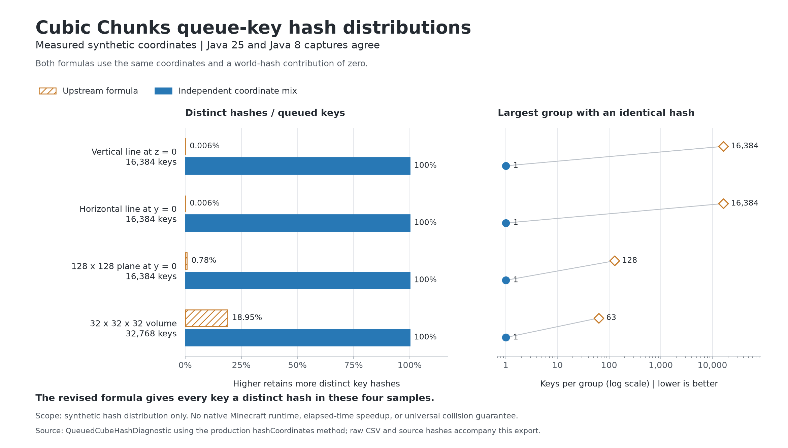

# Cleanroom and Java 25 development

This fork targets Minecraft 1.12.2 on Cleanroom 0.6.13-alpha / JDK 25.
Forge 14.23.5.2860 / Java 8 remains an explicit fallback artifact. Both use
the upstream CubicChunks API and source tree, including the earlier
[asynchronous completion ownership fix](riven-io-completion.md).

The isolated `cleanroom/` project uses the Cleanroom Unimined conventions.
The repository's original ForgeGradle project is preserved. Build each
artifact with a JDK 25 launcher:

```sh
cd cleanroom
./gradlew build
./gradlew -PcubicLoader=forge build
```

Use `gradlew.bat` on Windows. The remapped runtime JARs are under
`cleanroom/build/cleanroom/libs` and `cleanroom/build/forge/libs`. The
`*-dev.jar` files are development outputs, not native runtime artifacts.

The port does not bundle Mixin into Cleanroom. The Forge fallback uses
MixinBooter. Minecraft mods belong in remapped mod configurations; ordinary
Java libraries remain separate. Native world mutation, lighting, event
publication and saving keep their existing thread ownership.

The bundled RegionLib is the hash-verified maintainer publication
`0.78.0-20210527.114505-2`; its matching source revision and license are
recorded under `cleanroom/licenses/regionlib`. The old flow-noise embed
has no uses in the mod or API and is omitted. Addons that implicitly relied
on that bundled library have not been qualified.

The port supplies MCP nullability metadata for compilation only. It does
not bundle that shim, Minecraft classes, or Mixin. Soft-interface bridges
preserve the public CubicChunks names while vanilla methods are remapped;
the overloaded pathfinding injection now identifies its exact target.

## Java 25 watchdog

The vanilla compatibility generator's watchdog previously called
`Thread.stop()`, which throws on Java 25. It now records one diagnostic per
active nested generation operation and keeps at most 32 recent stack
samples. Reports remain available to Minecraft's crash-report callable.
This policy applies to both artifacts: the watchdog does not stop or
interrupt the generation thread. Fatal recovery from a truly stuck
generator requires the server's watchdog or external supervision.

The Riven cube generator does not use this vanilla compatibility watchdog.
Its state transitions have focused tests; native timeout recovery is not
qualified by Riven's generation tests.

## Build validation

Both source-built remapped artifacts pass the focused async-completion,
hash-distribution and watchdog tests on their target JVMs. Build checks
also verify Java 25 / Java 8 bytecode, the six mixin configurations and
generated refmaps, public API naming, library checksums and packaging.
The original LaunchWrapper-based upstream test suite is not part of this
new test task and has not passed here.

The subsequent [persistence and profiling pass](cubic-profile-pass1.md) adds
region-file and heightmap-format regressions, canceled-load ownership and
callback identity coverage, and native generation/save/restart checks for both
loaders. It includes exported JFR diagnostics and measured heightmap allocation
reductions, with the remaining runtime and performance limits recorded separately.

## Cube lookup hash

The old queued-cube hash multiplied Y by Z. At Z=0, every Y for a fixed X
and world had the same hash; at Y=0, every Z had the same hash. Mixing each
coordinate independently removes these predictable collision planes in
the async cube task map. Equality and saved-world keys are unchanged.

The [synthetic diagnostic](measurements/hash-distribution/README.md)
measures hash and bucket distributions for fixed coordinate sets. It does
not measure lookup latency, native generation, disk I/O, server throughput
or frame rate. Both Java 25 and Java 8 produce the same measured distributions.



## Riven integration

Use a fresh instance for each changed artifact and record the actual JAR
hash. Riven's normal dependency pin and previous worlds remain separate
from fork experiments. The current Riven held-map integration supplies
`common.MixinItemMap` under CubicChunks' package, satisfying an upstream
configuration entry whose source is absent from CubicChunks. That entry
is retained so this integration continues to load. Standalone CubicChunks
without that bridge still has the known missing optional map mixin.

## Native validation

The source-built fork passed fresh-world generation, save/stop and restart
checks on Windows with Cleanroom 0.6.13-alpha / Temurin 25.0.3 and Forge
14.23.5.2860 / Temurin 8u492. Each instance used Riven's pinned GregTechCEu,
Susy-Core and demonstrated startup dependency closure (24 mod JARs in all).
Neither third-party binaries nor existing player instances were modified.

| Check | Cleanroom / Java 25 | Forge / Java 8 |
| --- | --- | --- |
| Source build and focused regressions | Pass | Pass |
| Native generation and restart | Pass | Pass |
| Writes at -128, -1, 256, 383; reject -129 and 384 | Pass | Pass |
| 512 generated block states compared with the Riven model | Pass before/after restart | Pass before/after restart |
| Block light at -120 and 272 | Source 15, neighbor 14 retained | Source 15, neighbor 14 retained |
| Furnace inventories at -120 and 272 | Three diamonds each retained | Three diamonds each retained |
| Independent saved-file fixture inspection | Pass; 4,638 saved cubes | Pass; 4,638 saved cubes |
| Held-map height, transparency and water-shading fixtures | Pass | Pass |
| Shutdown | Exit 0, no shutdown exception | Exit 0, no shutdown exception |

The held-map checks exercise server-side sampling and Riven's external map
bridge, not client rendering. The generation comparison samples one
unmodified column. The saved-cube count describes these test worlds and
is not a coverage, memory or performance guarantee.

Tested runtime artifact SHA-256:

```text
Cleanroom c0fa34c71c1eb297c6043ef83ed3d59244fcb6126589ddce99a57832384f48ef
Forge     45df5fbacf545dd0f0d0d9e1f9e958b2953c0feba866b6096c62a53dfe25cd2d
```

The [machine-readable record](measurements/native-validation.json) retains
artifact/receipt/log hashes, commands, fixture results and comparisons
with previous profile logs. Existing recipe, advancement and Pyrotech
configuration errors remain; passing these probes does not mean the
reduced content profile has no errors.

One initial Cleanroom run is retained as a failed probe: its old test
expected vanilla stone below zero, but Riven's current generator places
its configured geology there. All its height, lighting and inventory
checks passed before that assertion. The corrected probe compares the
full 512-block column with the current model; the table uses a new world.

Native reproduction in the Riven workspace uses its current experimental
Riven artifacts and configured loader JVMs. For example:

```powershell
python tools/experiment_cubic.py prepare --name cubic-fork-cleanroom-next --loader cleanroom --scope kernel --generator riven-cubic --cubic-jar dev/CubicChunks-cleanroom/cleanroom/build/cleanroom/libs/CubicChunks-1.12.2-0.0.1301.0-riven.1-SNAPSHOT-cleanroom.jar --cubic-source-checkout dev/CubicChunks-cleanroom
python tools/experiment_cubic.py run --name cubic-fork-cleanroom-next --phase write
python tools/experiment_cubic.py run --name cubic-fork-cleanroom-next --phase read
.local/venv/Scripts/python.exe tools/inspect_cubic_world.py .local/instances/cubic-fork-cleanroom-next/riven-dev --output .local/experiments/cubic-chunks/cubic-fork-cleanroom-next-saved.json
```

Wait for each process to exit successfully before starting its next phase.
Use a new name and the Forge artifact with `--loader forge` for the
fallback. Map checks require another fresh instance with `--map-probe`,
then `--phase map`. The collector in this fork reads the named validation
instances without changing them:

```text
python tools/collect_riven_validation.py --riven-workspace E:/WorldGenOverhaul
```

Still unqualified: client launch/rendering, network play, OptiFine and
Bukkit hybrid integrations, the full upstream LaunchWrapper test suite,
long-running load/unload and concurrent native I/O stress, complete addon
compatibility, terrain/content/progression parity and native performance.
Optional OptiFine/Bukkit and wildcard-selector remap warnings remain
visible. The prior synchronous load-event recursion limitation remains.
The port keeps native world mutation on its existing owner thread; it
does not introduce concurrent chunk generation or virtual-thread I/O.
