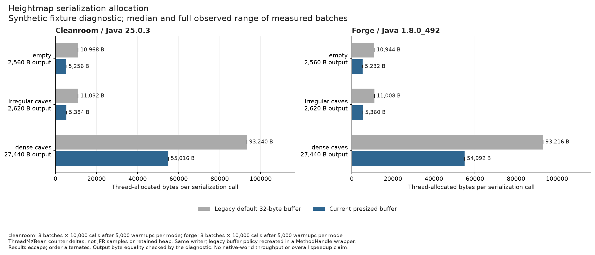
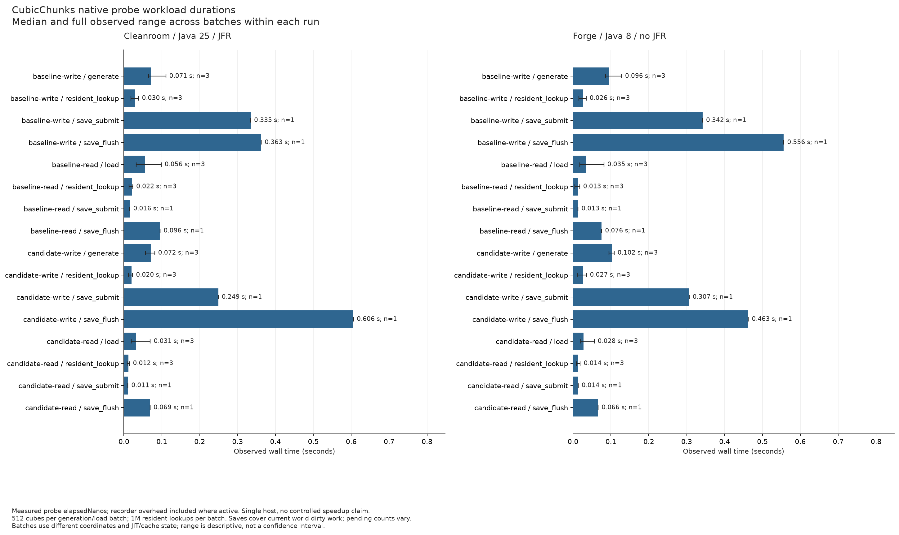
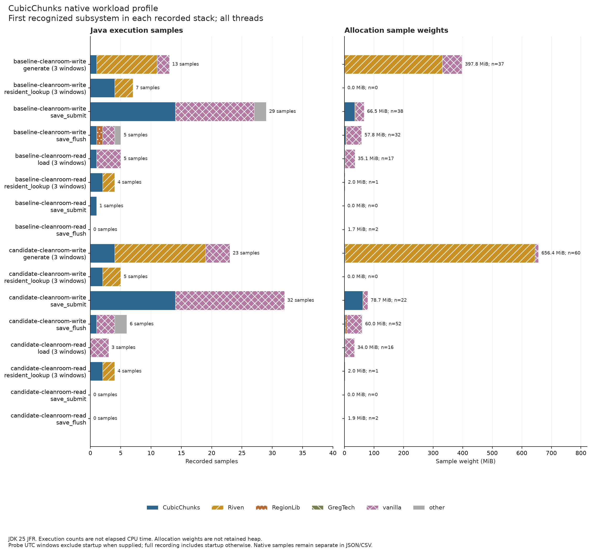

# CubicChunks persistence and profiling pass

The fork now releases canceled cube loads without publishing orphaned cubes,
preserves callback identity through provider wrappers, completes cached
population/lighting requests, and handles partial or corrupt region reads safely.
Biome and lighting arrays are detached when save snapshots are made. Heightmap
serialization uses a buffer sized for its existing binary format.

Both target builds and their focused regressions passed: Cleanroom 0.6.13-alpha
on Temurin 25.0.3 and Forge 14.23.5.2860 on Temurin 8u492. Native generation,
save and restart/read probes passed on both loaders. This report covers the
source changes at `5ae2e37afa2aa7bbed08ec5bf917abf279ef0c55` against baseline
`fd5633888d5f0d3e87332d06f336b0af7ad7d747`.

## Measured allocation reduction

The baseline save-submission recording showed block and heightmap serialization
in the sampled stacks. Pre-sizing the heightmap output buffer removes expansion
arrays while retaining the same writer and defensive result copy. Exact-byte
tests cover empty maps, irregular caves, dense caves and unused segment capacity.

| Fixture | Java 25 before / after, bytes per call | Java 8 before / after, bytes per call | Reduction |
| --- | ---: | ---: | ---: |
| Empty | 10,968 / 5,256 | 10,944 / 5,232 | 52% |
| Irregular caves | 11,032 / 5,384 | 11,008 / 5,360 | 51% |
| Dense caves | 93,240 / 55,016 | 93,216 / 54,992 | 41% |

These are median ThreadMXBean allocation counter deltas for three batches of
10,000 calls per mode after 5,000 warmup calls per mode, with measurement order
alternating. The historical 32-byte buffer policy is reproduced around the
unchanged production writer through a cached MethodHandle. Result arrays escape,
and output byte equality is checked. Wrapper and result allocations are included.
The native save-snapshot fix deliberately allocates independent live-array copies;
this table establishes only the heightmap serialization reduction.



## Native workload observations

Four disposable instances cover baseline/candidate and both loaders, each with a
fresh-write and saved-world-read process. The Riven experimental generator uses
the existing reduced GregTechCEu/Susy-Core dependency closure. Each timed workload
requests three remote batches of 512 cubes and performs one million resident
lookups per batch. Save submission and flush include dirty spawn content and
columns as well as the requested cubes. Candidate callback and snapshot fixtures
execute after the timed phases.

The host is an Intel Core i9-13900K with 32 logical processors. Cleanroom runs
record JDK 25 JFR with profile settings; Forge runs retain explicit probe timings
without JFR. Each process uses a 1 GiB initial / 6 GiB maximum heap. The Forge
candidate processes ran after an overnight pause. These are observations from
one host, with different coordinates, JIT/cache state and scheduling between
batches and processes.

The Cleanroom fresh-write save-submission observation decreased from 335 to
249 ms, while flush increased from 363 to 606 ms. The Forge observations decreased
from 342 to 307 ms for submission and from 556 to 463 ms for flush. Each save
phase has one observation; these mixed results do not establish an overall
throughput improvement or sustained-play performance.

`IONbtWriter.writeBlocks` appears in 16 of 29 baseline and 15 of 32 candidate
Java execution stacks during fresh-write save submission. These are inclusive
stack counts, not elapsed CPU percentages. Generation and reload windows have
few samples, so they cannot support precise hotspot rankings. The exports retain
full-recording startup/shutdown separately from explicit workload UTC windows,
and separate Java execution, native method and allocation samples. GC, recorded
file I/O, parks and monitor waits are also retained with their sampling limits.





## Persistence and bug coverage

Offline inspection found 6,174 saved cubes in each world, spanning non-air blocks
from Y=-128 through Y=383. Baseline/candidate and cross-loader comparisons match
the seed, per-Y cube counts, aggregate block counts, four boundary block fixtures,
two lighting fixtures and two furnace inventories containing three diamonds.
This is fixture and aggregate equality; it is not an exhaustive block-by-block
world comparison or terrain/content/progression parity.

Both candidate loaders also complete cached population and lighting callbacks
and keep column-biome, block-light and sky-light snapshots unchanged when the live
arrays are temporarily mutated and restored. The optional cube-biome array is
uninitialized in these worlds and is explicitly recorded as skipped.

Region regressions exercise short reads, EOF, no-progress reads, invalid payload
lengths, exact-sector boundaries and real RegionLib external-storage fallback
with reload. Async regressions exercise queued/running cancellation, replacement
ownership, rejoining abandoned reads, cleanup after exceptions, and cancellation
reentered after native publication has begun. These focused tests do not qualify
native player-watcher cancellation or multiplayer lifecycle behavior.

The reduced profile retains its existing recipe, advancement and Pyrotech errors:
186 ERROR messages on fresh writes and 199 on reads in both variants/loaders.
Normalized message signatures and counts match after replacing the disposable
instance root and Java object identity suffixes. Raw messages remain in the
receipts; there are no new normalized ERROR signatures in this comparison.

Runtime JAR SHA-256 values:

```text
Cleanroom 903e1cd3f3e2c3af07e9e50de4177b17b70a8e9581e9c41ac3bb14d8e9b15ae8
Forge     2184c1b3030f467eb4df5aadf74bf27a5a9544341ca5940e5b7d539d0a5d3e3f
```

## Evidence and reproduction

The [measurement directory](measurements/cubic-profile-pass1/README.md) contains
PNG/SVG charts, raw timing/allocation CSVs and analyzed JFR summaries. Its
[manifest](measurements/cubic-profile-pass1/evidence/manifest.json) links artifact
hashes, harness inputs, successful run receipts and saved-world/error comparisons.
Complete JFR binaries and expanded event exports remain in the Riven workspace's
ignored `.local` directories; the public summaries retain their hashes. Archived
harness files are inputs used in the Riven checkout, not standalone launch tools.

Use the parent [port instructions](cleanroom-port.md) to build both artifacts.
The Riven harness accepts `--profile-cubes` on fresh write/read runs and
`--profile-callbacks` for the candidate regression fixtures. Preserve each run's
evidence and use a new instance name for another comparison. Analyzer and
collector commands are documented in the measurement directory.

## Follow-up scope

Native queued cancellation/player-watcher lifecycle, long-running load/unload
stress, client rendering and complete addon compatibility remain unqualified.
Further bug work should address synchronous load-event recursion,
wrong-coordinate/nested `currentlyLoadingColumn` behavior, compression-error
buffer cleanup, and global executor shutdown ownership. A reader surviving the
best-effort shutdown retains its column pin; eventual cleanup is unresolved.

Block serialization is a supported next profiling target. Compression and region
flush deserve longer, repeated workloads before changing buffering or scheduling.
Keep world mutation and snapshot construction on their current owner thread.
