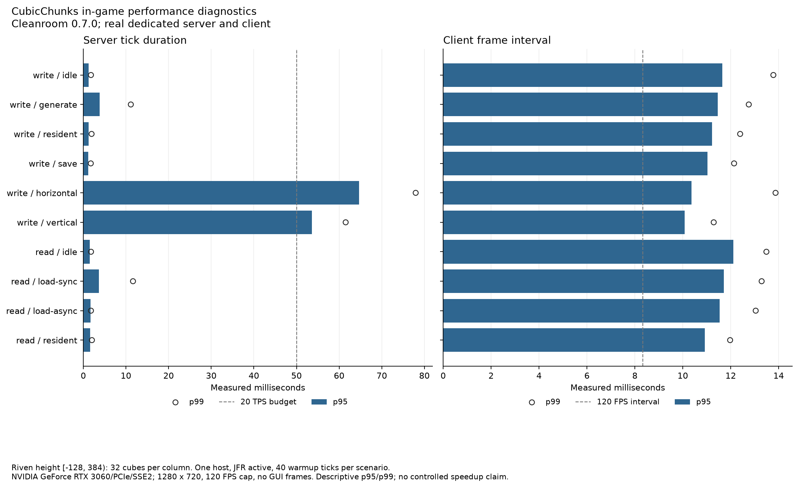
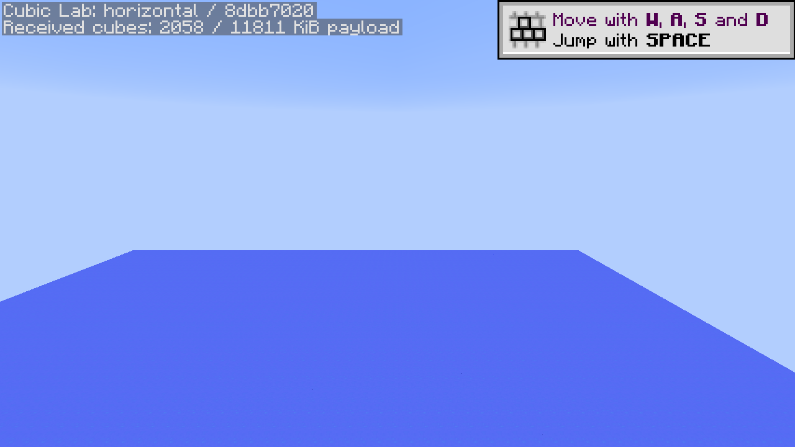
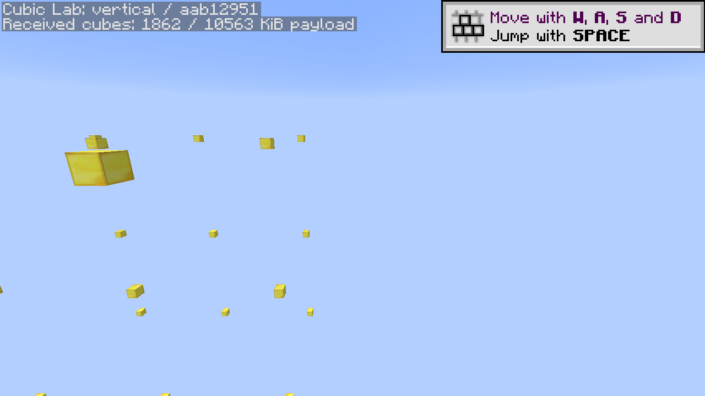

# First native CubicChunks lab measurements

The isolated **Cleanroom 0.7.0-alpha / Java 25** environment passed all ten default client/server scenarios and an independent stopped-world storage inspection on October 13, 2026. Every measured scenario captured real rendered frames with zero covering GUI frames. The fresh-JVM reloads recovered all 1,024 fixture markers, split evenly between synchronous and asynchronous cohorts, across Riven's complete allocated height **[−128,384)**.

Use the [lab guide](../../../lab/README.md) to rebuild, prepare a new revision, run the same workloads and export measurements. This suite is `lab-070-10`; earlier bootstrap failures and the shorter prototype route are preserved locally and are excluded from these measurements.

## Environment and evidence

The measured host is an Intel Core i9-13900K, 24 cores / 32 logical processors, approximately 63.7 GiB physical memory, NVIDIA GeForce RTX 3060 and Windows 11 Pro. Both Java 25.0.3 JVMs have 6 GiB heap limits. The real native client uses 1280 × 720, 120 FPS cap, vsync off, and view distance 3. Effective server view distance is 3 horizontally and vertically; the client's separate CubicChunks configuration value is 8. JFR profile recording is active in all four measured processes. Server and client share one machine and loopback network.

The mod set retains the demonstrated Riven kernel closure: 24 base JARs including experimental Riven and this CubicChunks fork, plus the optional lab JAR. Scalar also extracts twelve Scala/Akka library JARs under `mods/1.12.2`; every extracted file matches its embedded bytes in the pinned Scalar JAR. Full release metadata, selected Java, every mod hash, generated library ownership/hashes, client library hashes, generated input hashes and three lab-only 0.7 compatibility overlays are recorded in [results.json](results.json). The production fork binary is the existing `b23f1604` baseline, SHA-256 `903e1cd3f3e2c3af07e9e50de4177b17b70a8e9581e9c41ac3bb14d8e9b15ae8`. No production CubicChunks algorithm changed in this lab addition.

Raw local evidence is retained under `E:\WorldGenOverhaul\.local\cubic-lab\lab-070-10`: `runs/write` and `runs/read` contain client/server logs, commands, results and four original JFR recordings; `profile-exports` contains complete JFR JSON exports with 128-frame stacks and exact per-side workload windows. The server and inspected world are under `E:\WorldGenOverhaul\.local\instances\cubic-lab-lab-070-10`. The primed `CubicChunks-Lab-Prism.zip` contains owned client inputs, excluding worlds, accounts, caches and measurement outputs; its hash is recorded. Its GUI import through Prism remains untested. Generated-input hashes for this first suite were recorded after the suite when the primed ZIP was exported; the runner records inputs before launch for subsequent runs.

## Measured behavior

These are single-run observations. The tests passed their coordinate, saved-marker, capture and process-exit checks; passing does not imply they met a performance target.

| Workload | Operations | Server tick p95 | Server tick max | Client frame interval p95 |
| --- | ---: | ---: | ---: | ---: |
| Generate fixture | 1,024 cubes | 3.86 ms | 30.90 ms | 11.45 ms |
| Resident lookup, write JVM | 1,000,000 lookups | 1.24 ms | 314.42 ms | 11.21 ms |
| Save fixture | 1,024 cubes | 1.16 ms | 142.98 ms | 11.03 ms |
| Horizontal stream | 6 waypoints | 64.70 ms | 91.58 ms | 10.36 ms |
| Full-height vertical stream | 6 waypoints | 53.65 ms | 71.95 ms | 10.08 ms |
| Fresh-JVM synchronous reload | 512 cubes | 3.67 ms | 11.65 ms | 11.71 ms |
| Fresh-JVM asynchronous reload | 512 cubes | 1.66 ms | 1.79 ms | 11.54 ms |
| Resident lookup, read JVM | 1,000,000 lookups | 1.60 ms | 2.11 ms | 10.92 ms |

The write-phase resident scenario overlaps **6,140 cube-data save events** and has a 314 ms maximum tick. Its p95 does not describe that autosave stall. JFR samples in that window include `IONbtWriter.writeBlocks` and heightmap serialization. The separately timed lookup batches and the read-phase resident scenario provide narrower evidence of lookup work. The save scenario reports **39.60 ms total submission** and **131.93 ms blocking final flush**; submission includes the final dirty-column/global save request, while marker preparation is excluded from individual submit timing.

Horizontal streaming delivered **2,058 cubes / 12,094,976 serialized payload bytes**; vertical streaming delivered **1,862 cubes / 10,816,649 bytes**. Client decode totals were 2.61 ms and 2.07 ms, while measured main-thread cube application totaled 54.85 ms and 19.81 ms respectively. These totals overlap other work and must not be converted into exclusive thread time or network throughput. The full-height route observed cube Y −11 through 26: all 32 allocated cube levels plus 294 load events outside build height, consistent with the watcher's surrounding cube volume. Counts are load events, not retained heap or unique terrain blocks.

Both streaming workloads exceed the 50 ms server tick target at p95 and are useful future optimization fixtures. The JFR stack attribution also includes substantial **Riven generation work**: horizontal has 124 Riven and 57 CubicChunks attributed execution samples out of 216; vertical has 63 Riven and 17 CubicChunks samples out of 108. `HabitatCondition.expectation` and `LandscapeModel.reference` appear alongside CubicChunks lighting and staging-heightmap methods. These are stack-path sample counts, not CPU percentages or proof that CubicChunks alone causes the stalls. A controlled comparison should preserve this generator, height, view distance and input hashes and add repeated runs before making speedup claims.

Full tabular data, including idle scenarios and event counts, is in [metrics.csv](metrics.csv). Exact operation timings, GC counter deltas, sample counts and maximums are retained in [results.json](results.json). [JFR summary](jfr/summary.json), [hotspots](jfr/hotspots.csv), [subsystem counts](jfr/subsystems.csv) and [recorded events](jfr/recorded-events.csv) distinguish whole-process startup/shutdown from measured scenario windows. Allocation sample weights estimate pressure, not retained memory; I/O events are subject to recording thresholds.

## Storage and actual in-game captures

The [independent RegionLib inspection](world-inspection.json) validates **9,416 serialized cube coordinates**, Riven's height metadata, and all **1,024 gold markers** using the world's saved block registry. Susy deposit and host-rock registrations are present. Region file hashes accompany the inspection. This evidence covers this storage fixture; it does not establish biome correctness, terrain parity or progression balance.

These are real post-measurement native screenshots. The horizontal view shows the experimental ocean surface; the vertical view shows the upper fixture markers while traversing the full allocated height. They establish an actual rendered world, not visual acceptance of future Riven terrain. The initial client tutorial toast is an overlay; no menu/loading screen covered a measured frame.

## Limits and retained diagnostics

The 0.7 native runtime is newly released; compilation still uses the available 0.6.13-alpha Unimined development API. The lab's field bridge, missing Forge builder fallback and registry-holder initialization mixin are temporary isolated compatibility integrations. They do not qualify the full historical API or the complete Supersymmetry pack. Forge/Java 8 has separate build/focused-check coverage; this measured graphical suite uses Cleanroom/Java 25.

Startup logs retain dependency diagnostics, including AE2's signature expectation, missing Pyrotech ore/slag compatibility entries in the reduced profile, and vanilla advancements referencing unavailable recipes. The requested client shutdown also logs a socket reset after the measurements; both processes exit with code 0 and server saves finish. These observations prevent an error-free startup or progression-parity claim and are not hidden by the suite's PASS result. No additional content registrations were disabled to make this suite start, and no pinned third-party JAR was modified.

The fixture is bounded to 1,024 retained cubes with normal lab-owned tickets, two fresh process pairs and short spectator routes. Filesystem caches, thermal/power state and unrelated desktop scheduling are uncontrolled. Frame intervals include the 120 FPS cap, and capture windows differ by control-message latency. Neither these timings nor JFR samples establish an upstream speedup, long-running stress qualification or a native full-pack integration result.
