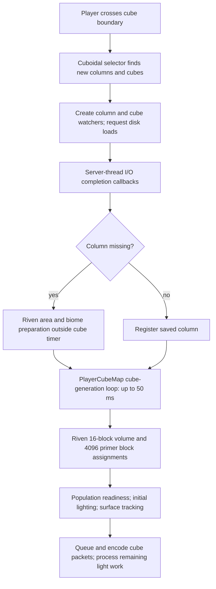
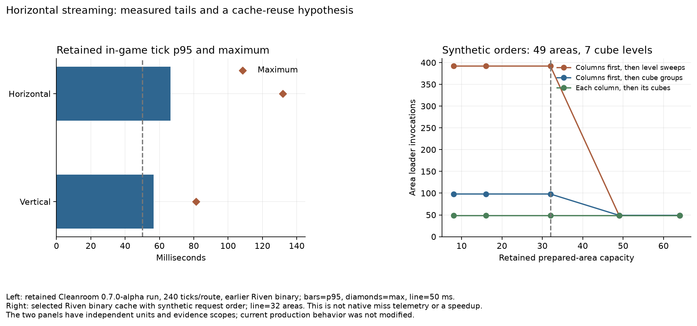

# Horizontal streaming source and profile audit

Horizontal movement currently combines new horizontal terrain/biome preparation, cube material generation, lighting and transmission on the server's critical path. CubicChunks' 50 ms cube-generation timer covers only part of that work. The most actionable source finding is **column generation outside that timer**, including through asynchronous load-completion callbacks. The strongest reuse hypothesis is **a 32-area cache serving a 49-column view**.

This is a source investigation and a synthetic cache diagnostic. It starts no new game and modifies no production Java, terrain, generation limits, dependencies or runtime inputs. The measured streaming observations come from the explicitly retained `lighting-pass-02` run; they predate storage pacing and Riven's preparation-worker binary. They are not measurements of the current candidate.

## Movement, loading and generation



1. [Player movement](../../../src/main/java/io/github/opencubicchunks/cubicchunks/core/server/PlayerCubeMap.java#L659) uses the [cuboidal selector](../../../src/main/java/io/github/opencubicchunks/cubicchunks/core/visibility/CuboidalCubeSelector.java#L57) to add/remove visible cubes and columns. Columns are introduced before cubes.
2. [Cube watchers](../../../src/main/java/io/github/opencubicchunks/cubicchunks/core/server/CubeWatcher.java#L88) first request `LOAD`, which reads disk data without directly requesting cube generation. In [queueCubeLoad](../../../src/main/java/io/github/opencubicchunks/cubicchunks/core/server/chunkio/async/forge/AsyncWorldIOExecutor.java#L218), however, cube setup requests its missing column at `LIGHT` readiness.
3. [Column completion](../../../src/main/java/io/github/opencubicchunks/cubicchunks/core/server/CubeProviderServer.java#L637) passes the result to `postProcessColumn`; a missing column and a requirement above `LOAD` can invoke `tryGenerateColumn`. [AsyncTaskCompletion.drain](../../../src/main/java/io/github/opencubicchunks/cubicchunks/core/server/chunkio/async/forge/AsyncTaskCompletion.java#L62) invokes all finished callbacks it encounters on the server thread, without a generation time/admission budget. The [world tick handler](../../../src/main/java/io/github/opencubicchunks/cubicchunks/core/server/chunkio/async/forge/AsyncWorldIOExecutor.java#L393) drives that completion path. This is a source-proven possible path; this audit does not count how often native generation took it.
4. The [explicit column generation loop](../../../src/main/java/io/github/opencubicchunks/cubicchunks/core/server/PlayerCubeMap.java#L338) also scans without a count/time limit. The cube deadline starts afterward at line 366. A new-column burst can therefore consume time before the cube budget even starts, or later in completion callbacks.
5. [CubeWatcher.providePlayerCube](../../../src/main/java/io/github/opencubicchunks/cubicchunks/core/server/CubeWatcher.java#L188) requests `LIGHT`. [CubeProviderServer.postCubeLoadAttempt](../../../src/main/java/io/github/opencubicchunks/cubicchunks/core/server/CubeProviderServer.java#L454) then generates, populates, initializes skylight and tracks the surface as needed. The current Riven adapter's population functions are empty and its requirements are `NO_REQUIREMENT`; generic population dependency amplification is not established as this adapter's cause.
6. Successful cubes are queued for [batch sending](../../../src/main/java/io/github/opencubicchunks/cubicchunks/core/server/PlayerCubeMap.java#L461). Initial lighting inside a `LIGHT` request belongs to that request's elapsed time; subsequent light-engine work, packet construction and other world tasks can occur after the timed loop. The timer cannot preempt an individual request.

The retained configuration has `maxCubeGenerationTimeMillis=50`, `maxGeneratedCubesPerTick=784` and `cubesToSendPerTick=649`. A 50 ms generation slice by itself consumes the entire 20 TPS tick target. It is not a 50 ms bound on all streaming/world work. The quota counts completed watcher requests rather than all possible generated dependencies; `chunksToGenerate >= 0` also permits one extra successful nonresident request. These are secondary accounting concerns beside the untimed column paths.

## Why horizontal movement is different

The inclusive view at distances 3/3 is 7×7×7 cubes, with 49 distinct X/Z chunk columns. [Exact selector geometry](visibility-geometry.csv) gives:

| Movement | Newly visible cubes | Newly visible columns |
| --- | ---: | ---: |
| One 16-block horizontal step | 49 | 7 |
| One 16-block vertical step | 49 | 0 |
| Lab horizontal 256-block teleport | 343 | 49 |

These are geometric requests, not measured actual generations. The lab horizontal route moves six times from X=2048 to 3328 at Y=80/Z=2048, with 40 observed ticks per waypoint. Its windows do not overlap horizontally. The vertical route instead visits Y=−120…376 at fixed X/Z=2048 after horizontal streaming has visited that X/Z area. Its step sizes, overlap, height contents and prior columns differ. Thus the historical horizontal/vertical difference does not isolate movement direction with equal cold work. Horizontal is the larger measured streaming tail, but this audit does not establish it as the largest possible stall in every workload.

## Riven's current preparation boundary

Current workspace source locations and their hashes are in [evidence.json](evidence.json). The selected frozen Riven artifact is `f2fc8f705b835107d36af5adeb8b4fb67c938d65794f3a6b52d815d2f4fbbd86`, retained from the preceding scheduled/storage lab passes. Inspection of its generator and preparation bytecode confirms the key boundaries below; that does not imply every newer workspace model is identical to this binary.

- `experiments/cubic/.../CubicProbeWorldType.java:90` generates column biomes through `BiomeColumns.write`. `RivenBiomeProvider.fill:48` uses `preparation.area` for aligned 16×16 queries.
- `TerrainPreparation.area:24` prepares 256 landscape columns, surface/habitat evidence and biome definitions. It divides pure calculation into four partitions.
- `PreparationService.calculate:57` submits those partitions to its bounded workers and waits for admitted work to finish at line 94. The server thread is still blocked until the required result is ready; these are parallel calculations inside a synchronous native request, rather than prepared-ahead native generation.
- `CubicProbeWorldType.generateCube:67` requests a height-16 material volume. `TerrainPreparation.volume:44` resolves its area first. Volumes use worker partitions only at heights of at least 64; current cubic slices calculate their 4,096 semantic material decisions directly on the caller, then bind/write block states on the server thread.
- Riven uses the default [generator readiness methods](../../../CubicChunksAPI/src/main/java/io/github/opencubicchunks/cubicchunks/api/worldgen/ICubeGenerator.java#L139), which immediately report `READY`; this adapter does not implement a nonblocking prepared-ahead poll.
- `PreparationService:20` retains 32 prepared areas globally, while even a single view-distance-3 footprint contains 49 areas. Loaded CubicChunks columns do not by themselves retain their Riven prepared area. Other worlds/players and surface support points can enlarge the active demand.

## Cache request-order diagnostic

The [diagnostic](../../../tools/diagnostics/RivenAreaCacheDiagnostic.java) exercises the selected binary's actual `SessionPreparationCache` with synthetic coordinate values. It makes 392 area requests: 49 column preparations and seven cube levels for 49 coordinates. No terrain calculations, native frames, memory-byte costs or timings are measured. It varies capacity and request order while checking returned coordinate identity.

| Artificial order, capacity 32 | Area-loader invocations | Cache hits |
| --- | ---: | ---: |
| All columns first, then sweep all 49 columns at each level | 392 | 0 |
| All columns first, then finish each column's seven cubes | 98 | 294 |
| Prepare each column immediately before its seven cubes | 49 | 343 |

At capacity 49, all three synthetic orders require 49 preparations. [All observations](area-cache-request-orders.csv) retain capacities 8, 16, 32, 49 and 64. This demonstrates a possible eviction/recomputation mechanism, not proof that current native watcher ordering follows the worst-case sweep. It motivates measuring actual area misses/evictions and request locality before increasing memory limits or changing scheduling.



## Retained profile evidence

The [original report](../lighting-current-runtime/README.md) pins Cleanroom 0.7.0-alpha, the earlier Riven SHA `a51d288766795186e46a08e9ddf3e50a75d9d316fdebbba52bb7a262d89852ae`, exact mod inputs and capture conditions. Each route has 240 observed ticks.

| Route | Tick p95 | Tick maximum | Riven execution-path samples | CubicChunks samples |
| --- | ---: | ---: | ---: | ---: |
| Horizontal | 66.36 ms | 131.94 ms | 155 / 243 | 36 / 243 |
| Vertical | 56.57 ms | 81.36 ms | 84 / 151 | 18 / 151 |

These are stack-path sample counts, not exclusive CPU percentages or method timings. Initial skylight is present in the inclusive stacks, and the horizontal window has three recorded GC collections versus two in the vertical window. Both windows have zero cube-data save events. The packet instrumentation observes 2,058 horizontal cube bodies versus 1,862 vertical cube bodies, with aggregate encode durations 2.96 ms and 30.71 ms respectively. Those isolated aggregate encode observations do not explain the larger horizontal tick tail; they exclude transport compression, other sending work and client rendering. They also illustrate why the complete routes cannot be treated as identical work.

`HashMap$TreeNode.find` is the leaf in 17 horizontal samples, with further tree removal/map-removal samples. This motivates checking model-cache coordinate hashes and eviction activity along with preparation counts. The profile alone does not identify which map, establish a present collision rate, or justify replacing collections throughout Riven/CubicChunks.

The current source and binary findings are consistent with an expensive cold-column/preparation path. The historical profile cannot establish its present miss rate, worker waits, exclusive cost or a post-storage speedup. No large raw JFR export was loaded or new native suite started for this audit; the retained scenario-scoped analysis was reused.

## Next experimental targets

1. Measure columns generated through each entry path, actual area misses/evictions, preparation wait time, generated cubes, first-light work and backlog per tick/waypoint. Split caller and worker timings. Use equivalent fresh one-cube moves plus separately labeled large teleports; record readiness latency as well as tick tails.
2. Give routine column generation and missing-column completion work a common generation admission/deadline model with cube generation. Retain explicit synchronous/forced calls, column pins, cancellation identity, same-position coalescing and server-thread publication. Merely reducing the existing cube timer leaves the bypass intact.
3. Test coordinate locality and bounded reuse before changing cache capacity. Enlarging the cache alone changes memory pressure; grouping must preserve distance priorities, delivery latency and fairness across players/worlds.
4. Investigate bounded pure preparation ahead of native publication through the existing readiness interface. Keep block registries, primers, population, lighting and saving on the owner thread. The JVM's extra threads do not remove these dependencies.

The audit leaves the engine and Riven implementations unchanged. The height/content requirements, fallback artifacts and deferred renderer/shader investigations remain preserved. No mod build or per-commit GitHub build is needed for this evidence-only pass.

## Reproduce without a game launch

From the Riven workspace, use a new output name and an explicit frozen artifact:

```powershell
.local/venv/Scripts/python.exe -B dev/CubicChunks-cleanroom/tools/investigate_horizontal_streaming.py --riven-jar .local/cubic-lab/storage-pass-inputs/riven.jar --output dev/CubicChunks-cleanroom/docs/measurements/<new-audit-name>
```

The tool compiles only the small cache diagnostic, reads the retained summary/report, and exports fingerprints, exact geometry, cache counts and PNG/SVG. The selected cache runs on Java 25; it is not a new Forge runtime qualification or a main-artifact build.
