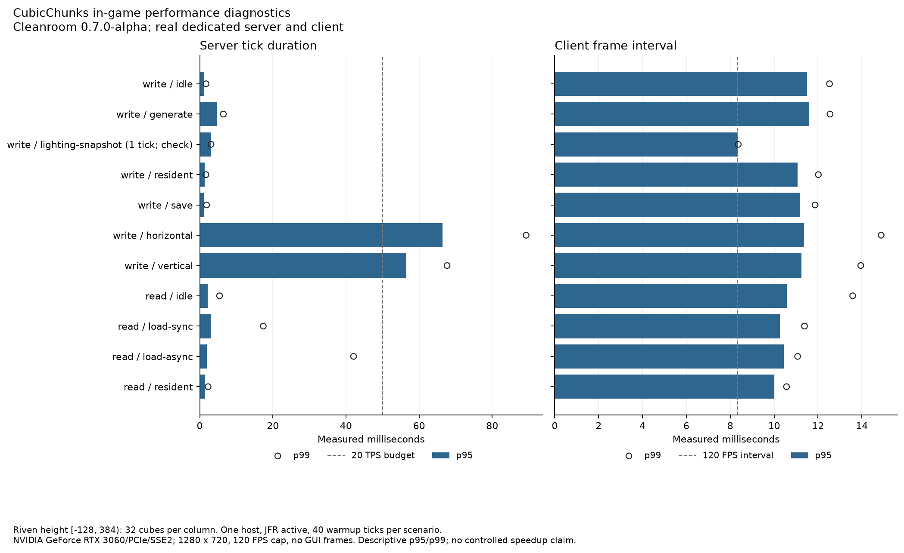
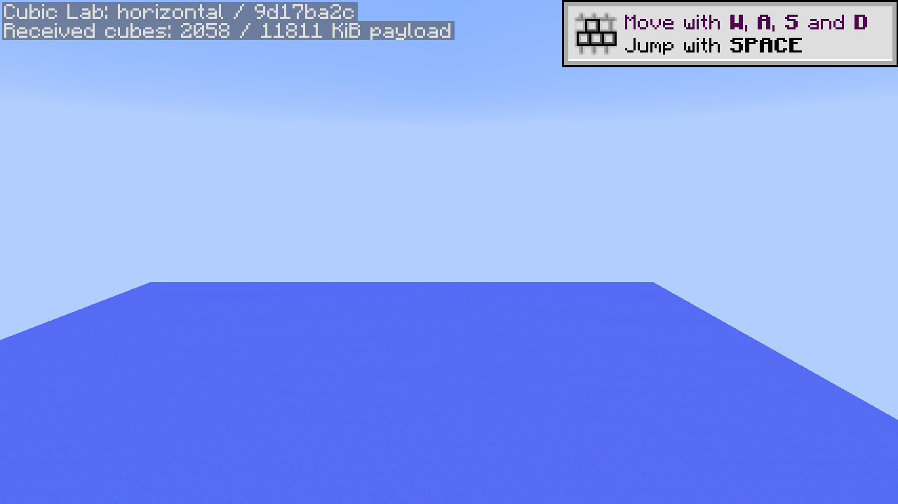
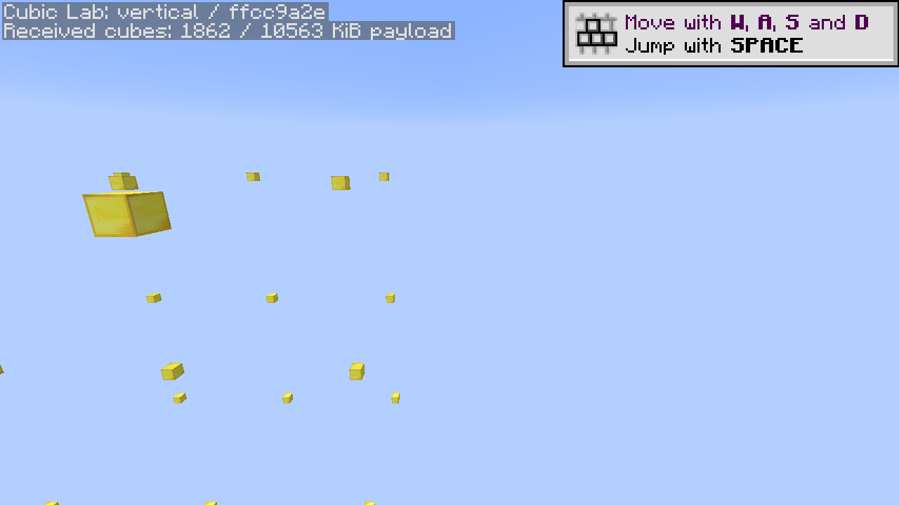

# Lighting candidate on the current matched runtime

The fresh `lighting-pass-02` baseline passed all eleven scenarios with a real client and dedicated server running **Cleanroom 0.7.0-alpha / Java 25** on October 13, 2026. Both installed universal JARs match the reviewed release SHA-256 `0a4c2c734895c6187342c11f513633e46143403496f7817d0c61db73853c4677`. Each measured capture has rendered frames and zero covering GUI frames. Lower/upper lighting snapshots remain independent; fresh-JVM synchronous/asynchronous reloads recovered all 1,024 markers; [independent stopped-world inspection](world-inspection.json) verified 9,416 saved cubes and all markers.

This is the current native baseline for the [first lighting/configuration batch](../../LIGHTING-FIRST-PASS.md). The earlier [mixed-runtime run](../lighting-first-pass/README.md) remains retained and separately labeled. The current runtime was prepared and tested using the existing validated CubicChunks/lab artifacts; no additional mod build or GitHub build was needed.

## Inputs and evidence

CubicChunks SHA-256 is `969c2521a1db44a3aaa1cbb83ed47ea03c8d2810ac9246dc51642b2361de27b6`; optional lab SHA-256 is `2f01ffa68e75f5cd44aef3e248f9c1bd841decbed514dd49ae092986f1396535`. Riven's independently updated prebuilt artifact is `a51d288766795186e46a08e9ddf3e50a75d9d316fdebbba52bb7a262d89852ae`. This Riven artifact differs from the prior run, so these are descriptive measurements and correctness evidence, not a controlled before/after comparison.

The same Windows host uses an i9-13900K, approximately 63.7 GiB RAM and NVIDIA RTX 3060. Both JVMs have 6 GiB heap limits; the client uses 1280 × 720, 120 FPS cap and vsync off. Effective server view distance is 3 horizontally and vertically. Riven's allocated height is **[−128,384)**, 32 cubes per column. JFR is active in all four measured processes; each scenario warms up for 40 ticks. OS caches, desktop scheduling and thermal/power state are uncontrolled.

[results.json](results.json) retains exact mod/library/runtime/configuration hashes, commands, phase results and raw log/recording fingerprints. [validation.json](validation.json) identifies source bytes and the locally validated artifacts. Raw evidence is `.local/cubic-lab/lighting-pass-02/runs/write` and `runs/read`; the stopped world is `.local/instances/cubic-lab-lighting-pass-02/riven-dev`. All owned processes exited normally. The lab's isolated 0.7 compatibility overlays and prior reduced-profile recipe/advancement/signature diagnostics remain part of this environment.

## Observations

| Workload | Operations | Server tick p95 | Server tick max | Client frame interval p95 |
| --- | ---: | ---: | ---: | ---: |
| write / generate | 1,024 | 4.61 ms | 10.99 ms | 11.61 ms |
| write / resident | 1,000,000 | 1.36 ms | 1.93 ms | 11.06 ms |
| write / save | 1,024 | 1.08 ms | 133.19 ms | 11.16 ms |
| write / horizontal | 6 | 66.36 ms | 131.94 ms | 11.36 ms |
| write / vertical | 6 | 56.57 ms | 81.36 ms | 11.24 ms |
| read / load-sync | 512 | 3.00 ms | 17.39 ms | 10.26 ms |
| read / load-async | 512 | 1.94 ms | 42.08 ms | 10.44 ms |
| read / resident | 1,000,000 | 1.46 ms | 2.41 ms | 10.01 ms |

The snapshot check performs two serializations in one measured server tick and a brief client capture. Its missing complete client-tick timing is null; these are diagnostic observations, not a latency distribution. Its two save events indicate serialization rather than durability. Ordinary save/reload checks establish the marker fixture's persistence.

The save maximum remains relevant despite its small p95. Horizontal and vertical streaming still exceed the 50 ms tick budget at p95. Both routes include Riven generation and CubicChunks work; this is not evidence that either alone causes the tails. The vertical route observed all 32 allocated cube levels plus 294 surrounding load events outside build height. Packet counts/bytes are serialized cube bodies and load events, not wire throughput, unique cubes or retained heap.

Full data is in [metrics.csv](metrics.csv). [JFR summary](jfr/summary.json), [hotspots](jfr/hotspots.csv), [subsystem samples](jfr/subsystems.csv) and [recorded events](jfr/recorded-events.csv) use exact per-side scenario windows and keep startup/shutdown separate. Execution samples are not exclusive CPU time; allocation weights are not retained memory; file-I/O events have recording thresholds.

Horizontal server streaming has 155 Riven and 36 CubicChunks attributed execution samples out of 243; vertical has 84 Riven and 18 CubicChunks out of 151. Those windows contain three and two recorded GC collections respectively. The save window has zero recorded collections despite its 133.19 ms maximum tick. These observations keep generation, lighting/storage work and GC distinct; they do not isolate this patch's effect.

## Actual captures and scope

These post-measurement native captures show the current experimental terrain/ocean and upper gold marker fixture. They do not qualify future Riven terrain, worldgen parity, progression balance, long-running stress or the complete Supersymmetry pack. Forge/Java 8 passed separate local build/focused checks; this graphical suite uses Cleanroom.

The [Celeritas option-off diagnostic](../renderer-option-diagnostic/README.md) is a separate rendering failure despite successful packet/capture protocol checks. Neither Celeritas nor Demonica is patched or incorporated into CubicChunks. GitHub workflows remain manual; commits do not trigger a build.
