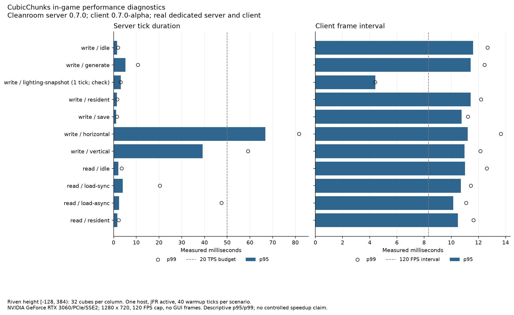
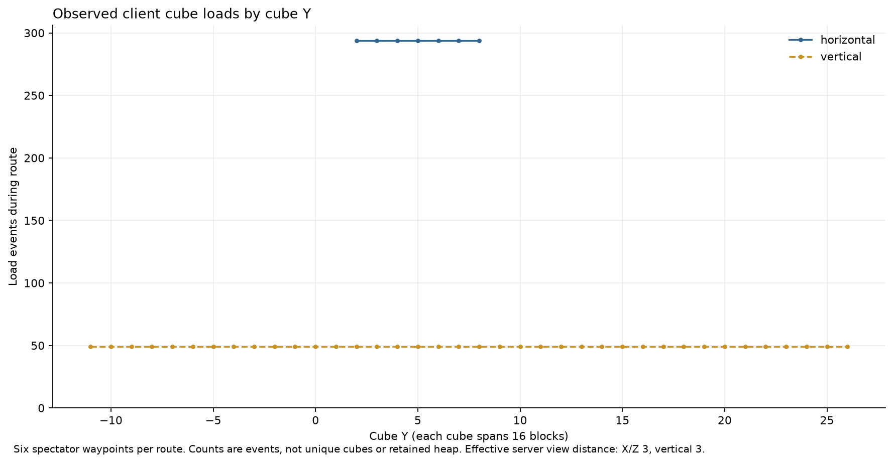
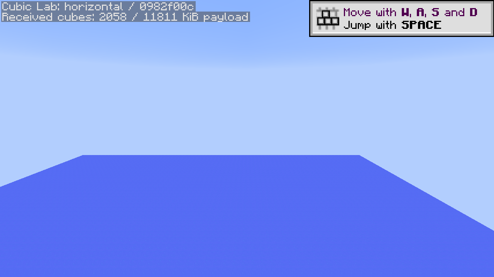
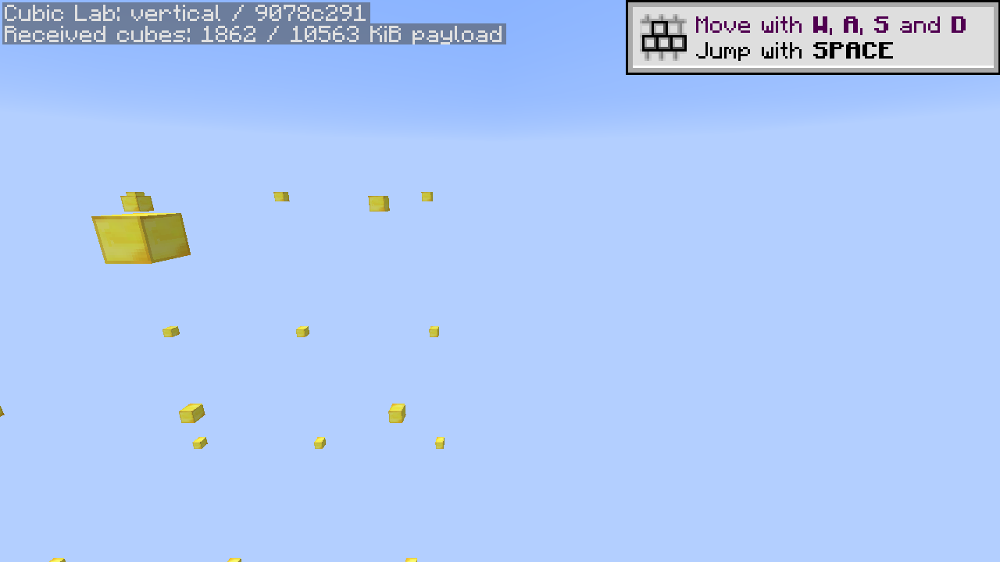

# Native lighting candidate measurements

The `lighting-pass-01` candidate passed all eleven native client/server scenarios on October 13, 2026. Lower/upper lighting snapshots remained independent of the live height array. Fresh-JVM reloads recovered 512 synchronous and 512 asynchronous markers, and [independent stopped-world inspection](world-inspection.json) verified all 1,024 markers and 9,416 serialized cubes across Riven's allocated height **[−128,384)**.

This validates the [first lighting/configuration batch](../../LIGHTING-FIRST-PASS.md) on the baseline renderer. It does not establish a speedup or external renderer/shader compatibility.

## Inputs and scope

The dedicated server and real client used Java 25.0.3, 6 GiB heap limits, NVIDIA GeForce RTX 3060, 1280 × 720, a 120 FPS cap, vsync off and effective server horizontal/vertical view distance 3. Each scenario had 40 warmup ticks, JFR was active in both process pairs, and all captured frames had zero covering GUI frames. The same Windows host's hardware is described in the [initial suite](../cubic-lab-v1/README.md); no controlled thermal/power or desktop-scheduling conditions are claimed.

The runtime input review found a **mixed product pair: server `0.7.0`, client `0.7.0-alpha`**, under release tag `0.7.0-alpha`. Upstream had replaced the release assets, but preparation still requested server `0.7.0`; the new installer successfully fetched that product before the old Maven installer became unavailable. The client came from the replacement Prism ZIP. Logs, library hashes and the original manifest establish both actual products. This is retained correctness/descriptive evidence for that exact pair, not qualification of the current matched-runtime default. Reporting records each side's observed version; new preparations check asset names/hashes and both installed universal JARs against the reviewed product. Development compilation uses the available Cleanroom 0.6.13-alpha API, with the existing lab-only 0.7 compatibility overlays. Forge/Java 8 passed separate local artifact and focused checks; this graphical run uses Cleanroom.

Candidate CubicChunks SHA-256 is `969c2521a1db44a3aaa1cbb83ed47ea03c8d2810ac9246dc51642b2361de27b6`; optional lab SHA-256 is `2f01ffa68e75f5cd44aef3e248f9c1bd841decbed514dd49ae092986f1396535`. Riven SHA-256 is `07ebdb8ee3080a62ca26b3e95e694e98c2425f8ca14e2f07f7c2c55ce86ce431`. Exact libraries, mod hashes, generated inputs, source receipts, commands and results are in [results.json](results.json) and [validation.json](validation.json). Existing external binaries were not patched.

Raw evidence is retained under `E:\WorldGenOverhaul\.local\cubic-lab\lighting-pass-01`: `runs/write` and `runs/read` contain logs, commands, results and four JFR recordings. The stopped world is `.local/instances/cubic-lab-lighting-pass-01/riven-dev`. Previous main/lab artifacts for both loaders are preserved under `.local/cubic-lab/lighting-batch-baseline`.

## Observed timings

These are single-run descriptive measurements, not acceptance targets or matched before/after results.

| Workload | Operations | Server tick p95 | Server tick max | Client frame interval p95 |
| --- | ---: | ---: | ---: | ---: |
| Generate fixture | 1,024 cubes | 5.27 ms | 32.43 ms | 11.42 ms |
| Resident lookup, write JVM | 1,000,000 lookups | 1.41 ms | 1.84 ms | 11.42 ms |
| Save fixture | 1,024 cubes | 1.10 ms | 136.30 ms | 10.76 ms |
| Horizontal stream | 6 waypoints | 66.83 ms | 101.53 ms | 11.20 ms |
| Full-height vertical stream | 6 waypoints | 39.22 ms | 80.96 ms | 10.98 ms |
| Fresh-JVM synchronous reload | 512 cubes | 4.08 ms | 20.41 ms | 10.70 ms |
| Fresh-JVM asynchronous reload | 512 cubes | 2.46 ms | 47.54 ms | 10.15 ms |
| Resident lookup, read JVM | 1,000,000 lookups | 1.70 ms | 4.01 ms | 10.49 ms |

The lighting snapshot check performs two serializations in one tick. It captured one frame interval and no complete client-tick timing; its percentile is a single observation, not a latency distribution. Its two save events mean serialization occurred, not that those snapshots were persisted. The subsequent ordinary save/reload scenarios establish marker durability.

Save submission totaled 39.86 ms and the blocking final flush 125.35 ms; the 136.30 ms maximum tick remains relevant despite the small p95. Horizontal/vertical streaming delivered 2,058 / 1,862 cubes. The vertical route covered all 32 allocated cube levels, with 294 surrounding load events outside build height. Counts are events, not unique cubes or retained heap. Packet bytes describe uncompressed `PacketCubes` bodies, not wire throughput.

The old suite has a different Riven artifact and phase sequence; the added snapshot check also shifts autosave timing. Timing differences cannot isolate this patch's effect. The reduction from 4,913 to 289 column notifications is verified coordinate coverage and a code-derived work count, not a 17-fold server-speed claim. Filesystem caches were not purged for the new JVMs.

Full data is in [metrics.csv](metrics.csv) and [results.json](results.json). JFR attribution is kept in [jfr/summary.json](jfr/summary.json), [hotspots](jfr/hotspots.csv) and [subsystem samples](jfr/subsystems.csv); sample weights are not retained memory or exclusive CPU percentages.

In the measured server windows, horizontal streaming has 142 Riven and 43 CubicChunks attributed execution samples out of 232; vertical has 53 Riven and 14 CubicChunks out of 100. Their windows contain four and three recorded GC collections respectively. Resident/save windows contain zero collections. Both generation and CubicChunks work therefore remain relevant; the save maximum cannot be attributed to GC from these observations. Startup/shutdown totals remain separate from these windows.

## Actual captures and remaining limits

These are post-measurement native captures. They show the current experimental ocean surface and upper fixture markers, not visual acceptance of future Riven terrain.

The reduced kernel retains its prior recipe/advancement/signature diagnostics. Successful storage and snapshot checks do not establish terrain parity, progression balance, delayed-writer stress, boundary-light correctness under arbitrary edits, full-pack integration or Celeritas/Demonica compatibility. GitHub workflows remain manual; local builds qualified this source batch rather than running for each commit.
