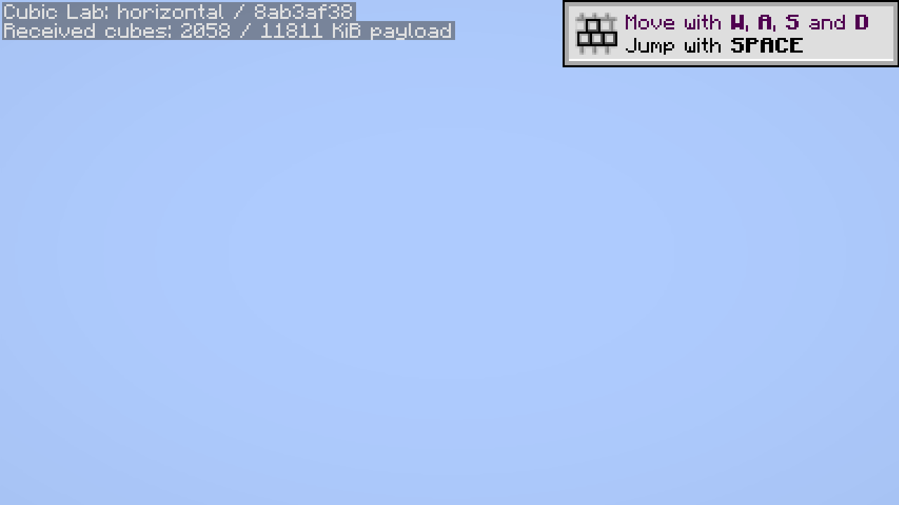
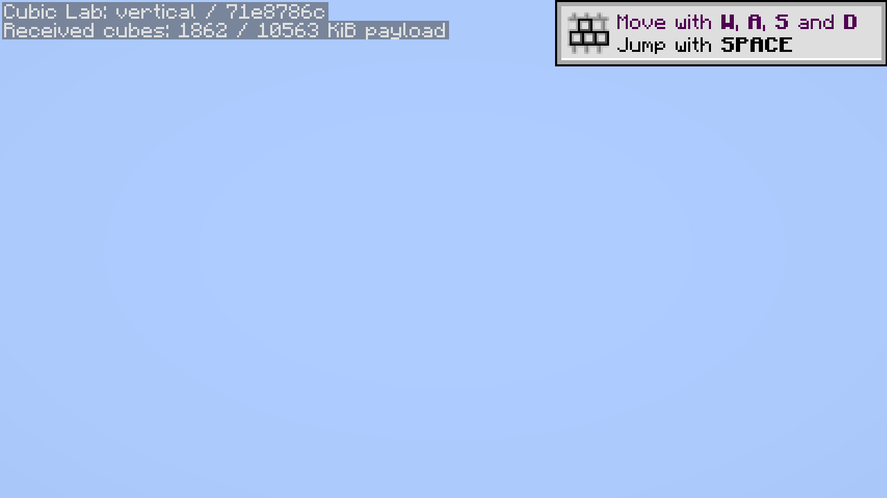

# Celeritas option-off diagnostic

The repaired CubicChunks `VERT_RENDER_DISTANCE=false` option permits the pinned Celeritas client to start, join and complete the generated-fixture, save and streaming workloads. **Terrain rendering still fails qualification:** the final horizontal/vertical captures show sky and the lab overlay without the baseline ocean or upper gold markers. A protocol/capture PASS is not a rendered-terrain PASS.

This uses `renderer-option-off-02`, matched Cleanroom product **0.7.0-alpha** / Java 25, the same CubicChunks/lab/Riven binaries as the [lighting candidate](../lighting-first-pass/README.md), and unmodified Celeritas `2.5.0-autobuild.9b661b70`. Both installed universal JARs match SHA-256 `0a4c2c734895c6187342c11f513633e46143403496f7817d0c61db73853c4677`. The option was set only in the client's existing CubicChunks configuration; dedicated-server settings and all required core injections remain enforced. Demonica is absent from this diagnostic.

[observations.json](observations.json) retains the exact manifest, runtime/artifact hashes, scenario results, real capture hashes, logs/JFR references and separate rendering qualification. Raw evidence is under `E:\WorldGenOverhaul\.local\cubic-lab\renderer-option-off-02`; the stopped server/world is `.local/instances/cubic-lab-renderer-option-off-02`. Both processes exited normally.

| Evidence | Observation |
| --- | --- |
| Horizontal route | 2,058 cubes received/applied as packet/load events; zero GUI-covered capture frames; no terrain visible in the final capture |
| Vertical route | 1,862 cubes received/applied as packet/load events; zero GUI-covered capture frames; no upper fixture markers visible in the final capture |
| Independent storage check | [9,416 saved cube coordinates and all 1,024 gold markers verified](world-inspection.json) |
| Earlier preparation attempt | `renderer-option-off-01` failed when the new installer was asked for the old product and its Maven installer returned 404; no client or measurement started. Failed files remain retained. |

The [source interface concerns](../../RENDERER-COMPATIBILITY.md) remain relevant: the pinned renderer obtains vanilla column storage arrays and assumes minimum height zero, while CubicChunks uses its separate cube map. The blank captures are consistent with an unresolved section/data interface, but do not identify every rendering defect or prove a single exclusive cause. Further work must preserve that ownership boundary and test negative, ordinary and high sections, edits/light sources and mesh invalidation. Neither external source nor JAR was patched.

The retained Demonica pair's GLFW/SDL loader failure is a separate historical result; this run makes no new shader claim. Different runtime products and an incomplete renderer make timing comparisons unsuitable as speedup evidence. New preparations check reviewed asset naming/hashes and installed runtime bytes; GitHub builds remain manual and this profile reused the validated Java binaries.

