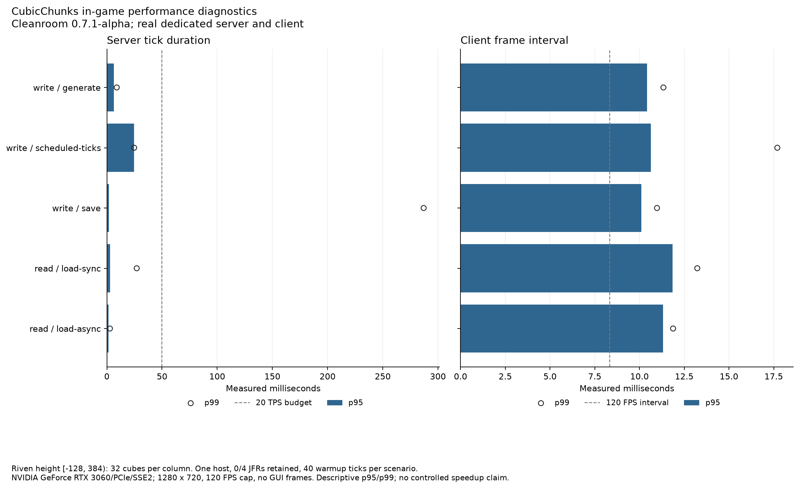

# Native scheduled-update checks

`scheduled-pass-01` passed the focused CubicChunks core fixture on Cleanroom **0.7.1-alpha / Java 25**, using the baseline renderer, on October 13, 2026. All **64 torch/water state transitions** completed at the **32 allocated cube levels**, including negative Y and heights above 255. The actual cube writer contained exactly one pending tick for each scheduled block despite duplicate scheduling requests. Consumed entries disappeared from the live cube index.

The write selection was `generate,scheduled-ticks,save`; a fresh process pair ran `load-sync,load-async`. Both phases passed client capture/process-exit checks. Each capture has real frame intervals and zero covering GUI frames. Synchronous/asynchronous cohorts recovered 512 markers each. [Independent storage inspection](world-inspection.json) verified all **1,024 markers and 6,463 saved cube coordinates**.

This verifies the [scheduled collection repair](../../SCHEDULED-TICK-PASS.md). It does not qualify delayed-tick disk-restart persistence, unrestricted water behavior, renderer/shader integration or a performance improvement. The scheduled diagnostic completed in six measured server ticks with 36 captured frame intervals; its operation durations include fixture preparation and scheduling-to-observed-state latency, rather than isolated callback cost.

## Exact inputs and retained evidence

[results.json](results.json) contains the full prepared manifest, actual per-side runtime versions, selected mod/library/configuration hashes, five scenario results and log fingerprints. [validation.json](validation.json) records source/artifact hashes and the local test/build checks. [Named-class observations](named-class-observations.json) confirm the collection contract fixes on Java 8 and 25 while preserving the other unresolved audit observations. [Runtime review](runtime-review.json) retains the official release selection and asset hashes.

The CubicChunks binary is SHA-256 `37c4af83417c7ea1f69a1d5e0407e968fd5b02371ad1d55e6083fc56022d3c2b`; lab binary is `d1797897b671952eb85a2f82d293cd1b35975540d9c78018b0d9f7f9c4a8a72a`. Riven's independently updated artifact is `f2fc8f705b835107d36af5adeb8b4fb67c938d65794f3a6b52d815d2f4fbbd86`. Both installed Cleanroom universal JARs match SHA-256 `97434a09a69341f4d9389713df935630c33524a75bf4bcf97c68d42528c05608`. The active Riven/development API pin is unchanged at 0.6.13-alpha; Forge/Java 8 has separate local artifact/regression coverage.

The same native Windows host uses the RTX 3060, 1280 × 720, a 120 FPS cap and 6 GiB heap limits per process. **No JFR recording** was requested. Riven's preparation service also runs in this profile; runtime, generator and workload differ from the earlier full streaming suite. The reduced profile retains prior recipe/advancement/signature diagnostics. These are functional checks and descriptive costs, not a controlled benchmark.

Raw evidence is retained under `E:\WorldGenOverhaul\.local\cubic-lab\scheduled-pass-01/runs/write` and `runs/read`. The stopped world is `.local/instances/cubic-lab-scheduled-pass-01/riven-dev`. Previous main/lab artifacts for both loaders are `.local/cubic-lab/scheduled-batch-baseline`; local build logs are `.local/cubic-lab/scheduled-batch-*-build.log`. Source probe outputs are `.local/cubic-lab/scheduled-contract-probe`. No player's save/Prism instance or third-party JAR was changed.

## Recorded costs

[metrics.csv](metrics.csv) retains exact timer fields and sample counts. Reporting accepts the focused subset and omits the cube-height load graph because no streaming route was selected. It records actual JFR presence rather than labeling every capture as profiled.

The pending-tick NBT check emits 32 ordinary cube-data save events while serializing snapshots. Those events do not prove disk writes. The subsequent ordinary save/reload fixture proves gold-marker durability, independently of the pending-tick diagnostic. No external renderer/shader compatibility check ran.
