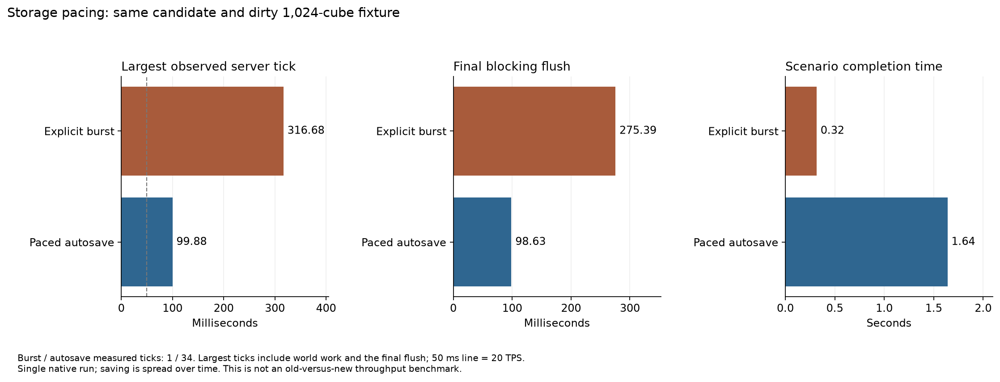
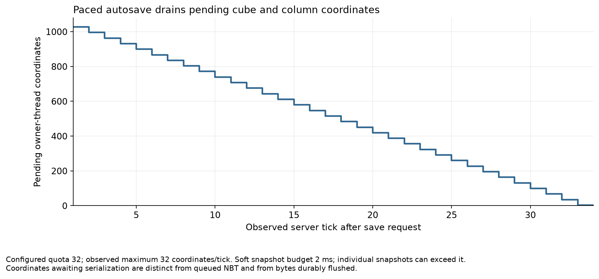

# Storage reliability and autosave pacing

The native `storage-pass-01` run passed bounded autosave, injected write-failure recovery and fresh-JVM persistence checks on **Cleanroom 0.7.1-alpha / Java 25**. Dirty cube snapshots can now be spread over ticks; explicit flush remains a blocking durability barrier. [Implementation and remaining limits](../../STORAGE-PACING-PASS.md) describe the exact behavior.

## Same-candidate measurements

Both save scenarios prepare the same 1,024 dirty gold-marker cubes across **[−128,384)** before capture, using the same candidate, client/server pair and frozen Riven input. They deliberately have different completion latency. This comparison is not a previous-version throughput benchmark or a repeated statistical speedup study.

| Observation | Explicit burst | Paced autosave |
| --- | ---: | ---: |
| Measured server ticks | 1 | 34 |
| Largest server tick | 316.68 ms | 99.88 ms |
| Initial snapshot/queue submission | 39.61 ms | 3.10 ms |
| Final blocking flush | 275.39 ms | 98.63 ms |
| Scenario completion | 0.32 s | 1.64 s |

Autosave server tick p95 was **3.99 ms**. Its coordinate queue declined from **1,027 to zero**, with no more than the configured **32 coordinates per tick**. The soft snapshot budget was 2 ms per dimension, and the routine NBT backlog threshold was 1,024 entries. The largest autosave tick includes the 98.63 ms flush; the quota does not make that barrier asynchronous or preempt one expensive snapshot. The burst has one tick, so its percentile is not a distribution.

[Download PNG/SVG figures, pacing CSV and provenance](graphs.zip). [Pacing metrics](graphs/pacing-metrics.csv) and [full scenario metrics](metrics.csv) retain explicit units and sample counts. `tools/plot_storage_pacing.py` reproduces the two figures from the validated result JSON without a build or game launch.

## Reliability checks

The native fault fixture uses real cube/column snapshots, the production bounded writer and RegionLib in a separate lab-owned directory. An injected pre-write failure stops automatic retries. Pending read copies cannot mutate the retained snapshot; a failed explicit flush reports the error and retains data. Replacement revision 2 then recovers on the third write attempt, and both cube/column bytes match the latest snapshots. This is a synthetic pre-write failure, not a physical disk or partial-write test.

A new client/server JVM pair recovered **512 synchronous and 512 asynchronous marker cubes**. Independent stopped-world inspection verified **all 1,024 markers and 6,463 saved cube coordinates**. All six selected scenarios passed with rendered frame intervals, zero GUI-covered frames and normal client/server exits. Forge/Java 8 has local build/regression coverage; the native graphical run uses Cleanroom.

## Inputs and profile evidence

[results.json](results.json) retains the manifest, exact runtime/mod/configuration hashes, client settings, scenario results and log fingerprints. [validation.json](validation.json) retains source bytes, matching tested/native artifacts, local checks and all four JFR fingerprints. The candidate was an uncommitted tested batch at preparation; later report/plot edits do not change its Java artifacts. Riven is frozen from the previous scheduled pass at SHA-256 `f2fc8f705b835107d36af5adeb8b4fb67c938d65794f3a6b52d815d2f4fbbd86`; the active Riven artifact and development API were not replaced. Development compilation remains Cleanroom 0.6.13-alpha. The baseline client uses the RTX 3060 at 1280×720, a 120 FPS cap, and effective server view distances 3 horizontally/vertically. Celeritas and Demonica compatibility remains deferred.

[JFR analysis](jfr/summary.json) uses exact per-side scenario UTC windows. The save-burst/autosave server windows contain no recorded GC collection. Native samples include `FileDispatcherImpl.force0` (3 burst samples, 8 autosave samples), consistent with time inside filesystem forcing, but those counts are neither exclusive CPU cost nor measured force duration. The short save windows provide sparse execution samples. Full-recording startup/shutdown and Riven background work remain separate scopes; they do not describe the measured save cost. Recorded I/O thresholds may omit fast operations.

[Named-class observations](named-class-observations.json) now show missing batch column/cube reads complete on both JVMs. The heightmap reuse/cache and new-lighting-queue findings remain open. The [world inspection](world-inspection.json) checks actual coordinates and saved block registry; it does not establish terrain parity or progression balance.

## Remaining limits and next work

Retained write snapshots reside in memory rather than a crash-recovery journal. Power loss, physical disk faults, atomic whole-batch writes, natural 6,000-tick autosave dispatch, multiworld reader shutdown and long-running stress are not qualified. Explicit save/unload submissions can exceed the routine pending-entry threshold; that threshold is not a hard memory-byte cap. Initial coordinate scans and individual snapshot/lighting calls can exceed the soft time budget. Reload uses new JVMs but does not purge OS caches.

The next measured storage target is the durability barrier: retain truthful explicit flush semantics while examining region forcing and dirty-file tracking. Separately, scope read-executor shutdown by world so closing a dimension does not stop other worlds' loads. Those changes need fresh fault, multiworld and persistence evidence. No per-commit GitHub build was dispatched.
