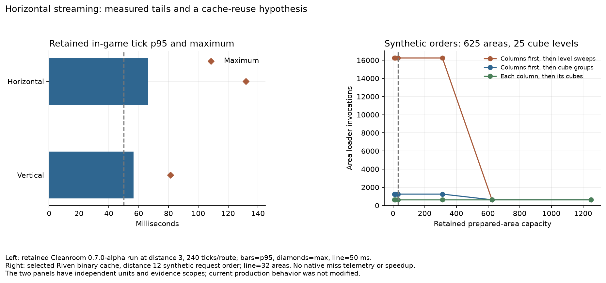

# View distance 12 diagnostic inputs

All new native tests now request horizontal, client render and CubicChunks vertical distance **12**. The lab records this profile, checks prepared settings before launch, and rejects captures with different effective distances. New Riven server preparations/Prism exports also select 12. Historical worlds/results retain their original settings; preparing a new instance is required for the changed workload.

The inclusive view is 25×25×25 positions: **625 columns and 15,625 cubes**. [Selector geometry](visibility-geometry.csv) gives:

| Movement | New cube positions | New column positions |
| --- | ---: | ---: |
| One 16-block horizontal step | 625 | 25 |
| One 16-block vertical step | 625 | 0 |
| Lab 256-block horizontal teleport | 10,000 | 400 |

The teleport now has overlapping old/new windows, unlike the retained distance-3 route. These are requested geometric positions, not measured generated cubes, blocks or retained memory. The allocated height remains [−128,384), and watcher positions may extend beyond it.

The [cache diagnostic](area-cache-request-orders.csv) uses the selected frozen Riven binary's real cache with synthetic area values and request order. It issues 16,250 requests over 625 areas/25 cube levels. With 32 retained areas, artificial level sweeps require 16,250 area-loader calls, columns-first cube groups require 1,250, and each column followed immediately by its cubes requires 625. Actual native cache misses and timing remain unmeasured by this diagnostic. Tested capacities include the real default 32 and the complete 625-area footprint; these diagnostic capacities do not alter production memory settings.

The left panel deliberately retains the earlier **distance-3** native observations from `lighting-pass-02`; it is not a distance-12 benchmark. The right panel is the new distance-12 synthetic diagnostic. [evidence.json](evidence.json) records source/binary/report fingerprints, the selected distance, exact commands and evidence limits. The preserved [earlier audit](../horizontal-generation-audit/README.md) remains useful source evidence but its numerical geometry/cache experiment belongs to distance 3.

Reproduce with a new output name using `tools/investigate_horizontal_streaming.py --riven-jar <frozen.jar> --output <new-directory>`. This compiles only the small standalone cache caller and starts no Minecraft or mod build.
