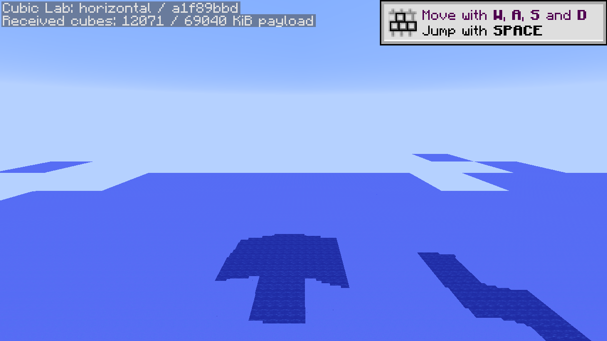
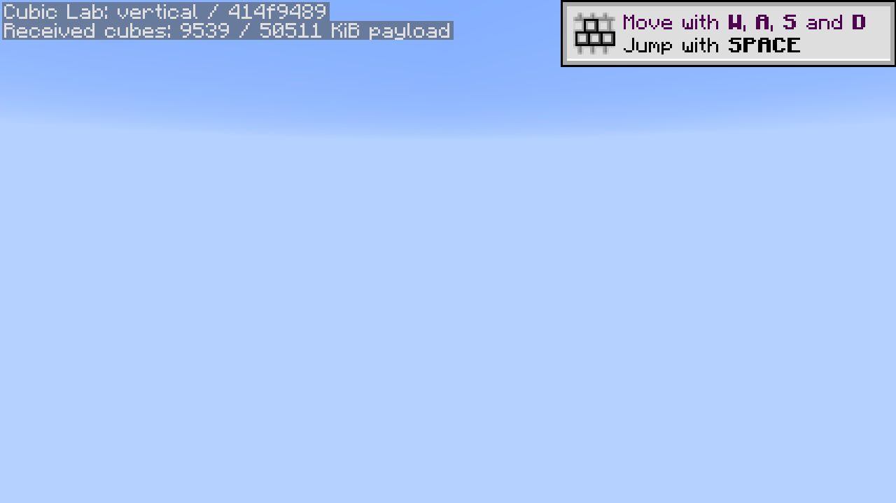

# Native view distance 12

All new lab runs enforce **12 horizontally, vertically and in the client render setting**. Fresh `view12-01` runs on **Cleanroom 0.7.2-alpha / Java 25** confirmed all four reported server/client distance values were 12 in each selected scenario. The runner rejects lower effective settings or changed preparation files. Historical results remain at their original settings.

The selected write scenarios were `idle,horizontal,vertical`; a fresh process pair then ran `idle` against the saved world. All four captures passed with rendered frame intervals, zero GUI-covered frames and normal process exits. The native client/server universal JARs match the reviewed release SHA-256. The same previously validated CubicChunks and optional lab JARs were reused with frozen Riven SHA `f2fc8f705b835107d36af5adeb8b4fb67c938d65794f3a6b52d815d2f4fbbd86`. No mod build or per-commit GitHub build was triggered. The active Riven/development API stays on 0.6.13-alpha; this native release was separately reviewed after preflight rejected the stale 0.7.1 pin.

## Observations

| Window | Server tick p95 | Server maximum | Client frame p95 | Received cube bodies |
| --- | ---: | ---: | ---: | ---: |
| Write / idle after join | 72.05 ms | 84.25 ms | 11.18 ms | 4,469 |
| Horizontal route | 80.10 ms | 1,363.17 ms | 12.37 ms | 12,071 |
| Vertical route | 73.21 ms | 125.00 ms | 11.43 ms | 9,555 |
| Restart / idle after join | 70.88 ms | 82.21 ms | 11.95 ms | 5,721 |

The joined-client idle windows still receive many cubes, so they are **active viewport-loading observations**, not settled idle-engine baselines. Each route uses six teleports and 240 observed ticks; it does not wait for the entire requested volume to finish at each waypoint. Horizontal and vertical work differ in direction, reuse, height contents and overlap. The horizontal maximum is a measured stall; no JFR was recorded here, so its exclusive cause is not established.

The streaming windows also contain **1,807 horizontal and 7,144 vertical cube-data save events**. These indicate snapshots, not completed durability, and demonstrate that the measured route includes more than generation. Unload/saving, preparation, lighting, packet handling, GC and other world work must be separated in a subsequent profile before assigning the large stall to one path.

[Download PNG/SVG figures, CSV and provenance](graphs/performance-graphs.zip). The [full metrics](metrics.csv) now include actual horizontal/vertical and client distances. [Results](results.json), [validation](validation.json) and [release review](runtime-review.json) retain inputs, checks and limits. The graph tool's `--timings-only` mode supports this selected workload, records real view settings and correctly reports zero retained JFRs.

## Actual captures and limits

The inspected horizontal endpoint shows rendered ocean patches with incomplete terrain coverage. The upper vertical endpoint is sky. These captures qualify settings/startup and rendered-frame observations, not a complete loaded view, full-height visual acceptance, terrain parity or progression balance. The partial coverage is retained as evidence rather than hidden behind the protocol's packet/frame pass.

This run does not repeat the 1,024 gold-marker storage fixture, establish arbitrary chunk persistence or qualify Forge native graphics. New JVMs do not purge OS caches. It uses a different Riven artifact, runtime and visibility workload from the earlier distance-3 profile, so that historical comparison does not isolate distance scaling or an engine speedup. Heap limits remain 6 GiB per JVM on the existing i9-13900K/RTX 3060 host; the client retains 1280×720, 120 FPS cap and disabled vsync.

The [distance-12 selector/cache diagnostic](../view-distance-12-diagnostics/README.md) uses a 625-column/15,625-position requested volume. Future timing experiments should record completion/backlog as well as tick tails so a smaller stall is not obtained merely by delaying visible terrain.
