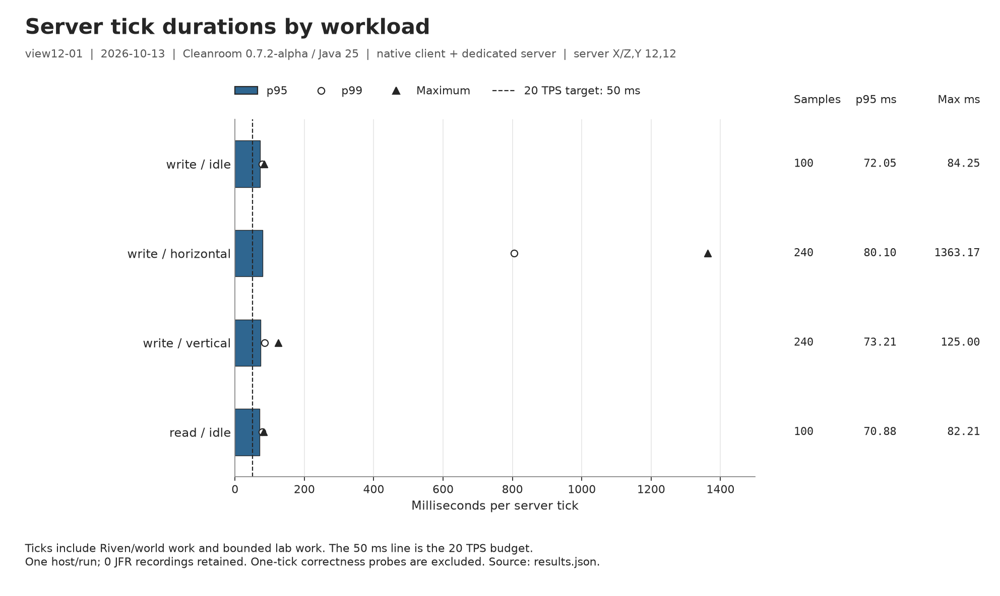
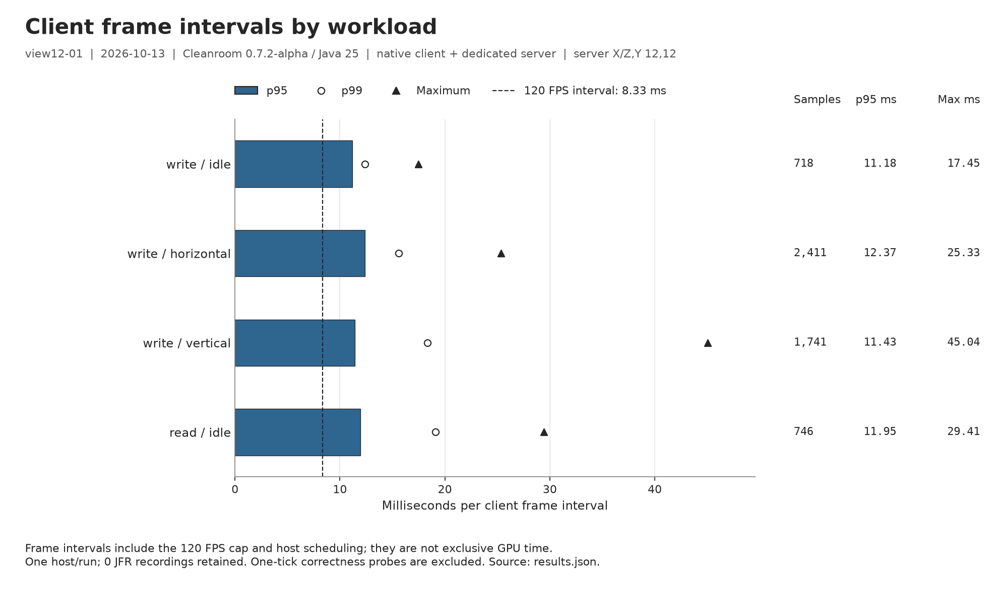

# Native performance graphs

view12-01  |  2026-10-13  |  Cleanroom 0.7.2-alpha / Java 25  |  native client + dedicated server  |  server X/Z,Y 12,12

Reproduce these figures with `tools/plot_cubic_lab_results.py --report <retained-results.json> --output <new-directory> --timings-only`. This command builds nothing and launches no game.

PNG files provide previews; SVG files preserve editable vector text. `graph-data.csv` retains exact timing fields, sample counts and run IDs. The snapshot correctness probe remains in the CSV but is excluded from the timing plots. Source/plotter hashes and exact mod inputs are in `provenance.json`.

Tick windows include world/lab work. Async latency includes queueing and tick dispatch; sync timers measure a different boundary. Save-call totals and flush time are not whole-workload duration or disk throughput. One host/run; 0 JFR recordings retained. Descriptive evidence, not a controlled speedup study.

